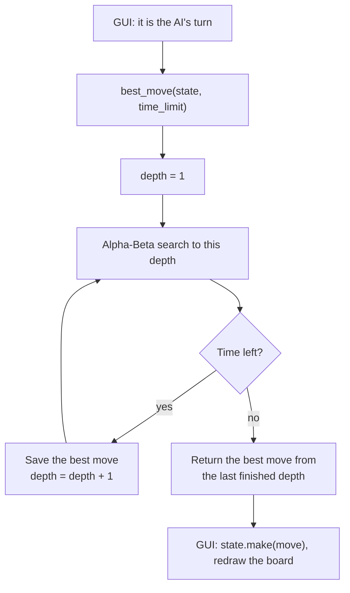
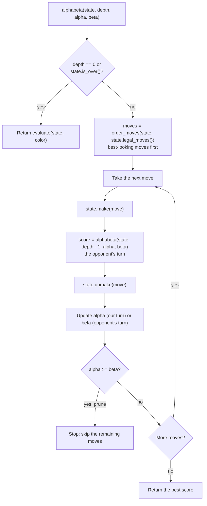
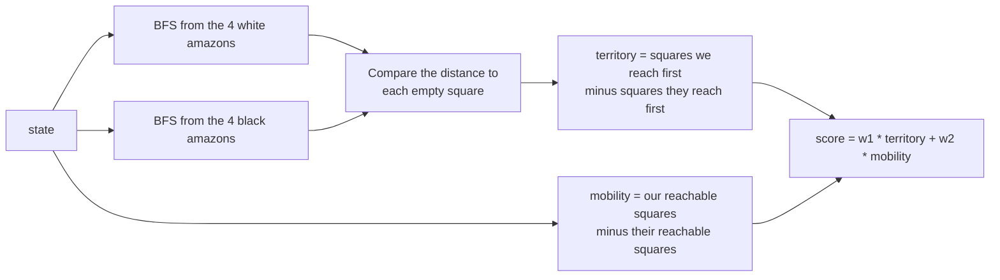

# Intelligent Game of the Amazons Player

AI310/CS361 course project: an AI that plays the Game of the Amazons using Minimax, Alpha-Beta pruning, iterative deepening and a BFS territory evaluation.

## How the AI works

### 1. One AI turn: iterative deepening (`search.py`)

The AI searches depth 1, then 2, then 3, and so on. When time runs out, it plays the best move from the last depth it finished, so a move is always ready.



### 2. Alpha-Beta search: one node (`search.py`)

Each call tries the moves of one position. It applies a move with `make`, searches the opponent's replies one level deeper, and takes the move back with `unmake`. When a move is already proven worse than an option found earlier (`alpha >= beta`), the remaining moves are skipped.



### 3. Evaluation: territory and mobility (`evaluate.py`)

At the depth limit the position is scored. A BFS runs from all four amazons of each side, where one step is one queen move. An empty square belongs to the side that reaches it in fewer moves.



## Shared interface

These names are agreed by the whole team. Do not rename them or change their parameters without the agreement of all six members.

| File | Name | Owner |
|---|---|---|
| `game_state.py` | `GameState`: `legal_moves()`, `make(move)`, `unmake(move)`, `is_over()` | Moaaz |
| `search.py` | `best_move(state, time_limit)` | Hazem |
| `evaluate.py` | `evaluate(state, color)` | Marwan |
| `ordering.py` | `order_moves(state, moves)` | Mohammed |
| `gui.py` | `main()` | Abdelrahman |
| `tests/` | test files | Alaa |

A cell is `row * 10 + col` (0 to 99). A move is `(from_cell, to_cell, arrow_cell)`. Square values: `EMPTY, WHITE, BLACK, ARROW = 0, 1, 2, 3`.

## Workflow

1. Clone the repository and create your own branch, for example `hazem-search`.
2. Fill in only your own file. If a part you need is not ready, use a simple fake with the same name.
3. Open a pull request to `main`; another member reviews it before merging.

## Run

Needs Python 3.11 or later with tkinter. The command name differs by system: Ubuntu has only `python3`, Windows has `py` (and `python`). Create a virtual environment once; while it is active, `python` works the same on both.

Ubuntu:

```
sudo apt install python3-tk python3-venv
python3 -m venv .venv
source .venv/bin/activate
pip install -r requirements.txt
```

Windows (PowerShell; tkinter is included in the python.org installer):

```
py -m venv .venv
.venv\Scripts\Activate.ps1
pip install -r requirements.txt
```

Then, with the environment active (`(.venv)` shows in the prompt):

```
python gui.py                    # window: human vs AI, AI vs AI, random player
python play.py human ai          # terminal; players: human, ai, random
python experiments.py            # five experiments, CSV and charts in results/
python -m pytest                 # tests
```

In a new terminal, activate the environment again first (`source .venv/bin/activate`, or `.venv\Scripts\Activate.ps1` on Windows).

## Report and diagrams

- Report: [docs/report.md](docs/report.md)
- Diagrams: [docs/diagrams/](docs/diagrams/), each as an `.excalidraw` source (open at excalidraw.com) and an `.svg` copy.
