# An Intelligent Game of the Amazons Player

AI310 / CS361 Artificial Intelligence, Fall 2026-2027, Project 7

| Member | Part |
|---|---|
| Moaaz | Game engine (`game_state.py`) |
| Alaa | Tests, random player, terminal play (`tests/`, `play.py`) |
| Hazem | Search: Minimax, Alpha-Beta, iterative deepening (`search.py`) |
| Marwan | Evaluation function (`evaluate.py`) |
| Mohammed | Move ordering and experiments (`ordering.py`, `experiments.py`) |
| Abdelrahman | Graphical interface and report assembly (`gui.py`) |

Repository: https://github.com/MoaazHF/Intelligent-Game-of-the-Amazons-Player

---

## 1. Project idea

The Game of the Amazons is a two-player board game on a 10×10 board. Each player has four amazons. A turn has two parts: one amazon moves like a chess queen (any distance in one of eight directions, without passing over a piece or an arrow), then it shoots an arrow, also like a queen, from the square where it landed. The arrow stays on its square for the rest of the game and blocks it. White moves first. A player who has no legal move on their turn loses. There are no draws.

Every turn removes one square from play, so a game lasts at most 92 turns. The difficulty is the number of moves: the start position has 2,176 legal moves, against 20 in chess. A plain Minimax search cannot look far ahead with that many moves per turn.

The aim of the project is a program that plays Amazons against a human or against itself. It chooses moves with Alpha-Beta search, iterative deepening under a time limit, a move-ordering heuristic, and an evaluation function based on territory (multi-source breadth-first search) and mobility.

## 2. Main functionalities

| Function | Where |
|---|---|
| Human vs AI, AI vs AI, human vs human | `gui.py` (player menus), `play.py` |
| Random player | `play.py` (`random_move`), GUI menu "Random" |
| Adjustable AI time limit and maximum depth | GUI spin boxes, `play.py --time` |
| Legal-move highlighting | GUI: destinations in green, then arrow squares in orange |
| Game-over detection and result | `GameState.is_over()`, GUI status line |
| Move log in standard notation (`d1-d7/g7`) | GUI move list, terminal output |
| Search statistics per AI move (depth, nodes) | GUI move list |
| Experiments with CSV data and charts | `experiments.py`, `results/` |

The interface stays responsive while the AI thinks: the search runs in a worker thread on a copy of the game state, and the main window picks up the result from a queue.

## 3. Similar applications

| Application | Platform | AI method | Notes |
|---|---|---|---|
| playstrategy.org | Web site | None (play between people) | Used to learn the rules and to check our move generation by hand |
| Little Golem | Web site, turn-based | None (play between people) | Games last days; each player moves when convenient |
| Invader (R. Lorentz) | Desktop program | Alpha-Beta with selective search, later Monte-Carlo tree search | Subject of papers 3 and 6 below |
| Amazong (J. Lieberum) | Desktop program | Alpha-Beta with a detailed territory evaluation | Its evaluation is described in paper 4 |
| Arrow (M. Müller) | Desktop program | Alpha-Beta search | Research program from the University of Alberta |
| This project | Python, desktop (tkinter) and terminal | Alpha-Beta, iterative deepening, move ordering, BFS territory | Full-width search; teaching scale, not tournament strength |

The strong programs differ from ours mainly in search width: they examine only a selected part of the moves at each node (papers 2 and 3), or replace full search by Monte-Carlo playouts (papers 5 and 6). Our search is full-width, which keeps it exact but limits its depth (section 6.4).

## 4. Literature review

**[1] Knuth and Moore (1975), An Analysis of Alpha-Beta Pruning.** The paper gives a formal definition of the alpha-beta procedure in its negamax form and proves that it returns the same value as full Minimax. Its main result is the cost in the best case: with perfect move ordering, a tree of branching factor b and depth d needs about b^⌈d/2⌉ + b^⌊d/2⌋ − 1 leaf evaluations instead of b^d. Alpha-Beta can therefore search about twice as deep as Minimax in the same time, but only when good moves are searched first. This is the reason for our move-ordering module, and experiment 2 measures the effect.

**[2] Hensgens (2001), A Knowledge-Based Approach of the Game of Amazons.** This MSc thesis describes the program ANKY. It analyses the complexity of Amazons and tests known search techniques under its very large branching factor. The history heuristic, killer moves and principal variation search did not help, because the program has to use a narrow selective search. What worked was a selective search combined with sorting moves by the evaluation function, together with a new "relative territory" evaluator that builds on Kotani's territory function. ANKY took part in the Computer Olympiad in 2000 and 2001 and solved Amazons on the 4×4 and 5×5 boards. For our project the thesis confirms territory as the main evaluation feature and shows why move ordering matters.

**[3] Avetisyan and Lorentz (2002), Selective Search in an Amazons Program.** The paper studies forward pruning in the program Invader: at each node only the most promising moves, chosen by a cheap estimate, are searched further. The time saved lets the program search deeper along the lines that matter. The paper shows that a well-tuned selective search plays better than a full-width search under the same time. Section 6.4 shows the problem it addresses: our full-width search reaches only depth 1 at the start position.

**[4] Lieberum (2005), An Evaluation Function for the Game of Amazons.** The paper presents the evaluation used in the program Amazong. It measures territory with two distance measures, the number of queen moves and the number of king moves needed to reach each square, and adds mobility terms that describe how free each amazon is. The weights of these terms change with the stage of the game: mobility matters more in the opening, territory more as the board fills. Our evaluation uses the queen-move territory and a simple mobility count with fixed weights, a reduced version of this design.

**[5] Kloetzer, Iida and Bouzy (2007), The Monte-Carlo Approach in Amazons.** The authors apply Monte-Carlo methods to Amazons: a move is scored by playing many random games from the position. Plain random playouts give weak play in Amazons. Results improve when domain knowledge is added, for example by stopping playouts early and scoring the position with an evaluation function. The paper shows that Monte-Carlo methods become competitive in Amazons only when combined with a good evaluation.

**[6] Lorentz (2008), Amazons Discover Monte-Carlo.** Lorentz rebuilt Invader around Monte-Carlo tree search (UCT). Each playout runs for a small, fixed number of moves and then the evaluation function scores the position. The Monte-Carlo version beat the earlier Alpha-Beta version of the same program. Papers 5 and 6 show strong Amazons programs moving from Alpha-Beta to Monte-Carlo methods. This project uses Alpha-Beta, the method the course covers.

## 5. Dataset

The program searches instead of learning, so it needs no labelled dataset. Two kinds of data are used:

1. Test positions. `make_positions` in `experiments.py` plays random moves from the start position and keeps the position as soon as the side to move has between 15 and 40 legal moves. The random seed is fixed (361), so every run and every experiment uses the same positions.
2. Game records. Every game played in experiments 4 and 5 is saved move by move in `results/games_exp4.csv` and `results/games_exp5.csv` with the columns `game_id, move_number, colour, from_cell, to_cell, arrow_cell`.

Hand-made positions in `tests/test_evaluate.py` are used to check the evaluation function against values computed by hand.

## 6. Algorithms and experiment results

### 6.1 Game engine

The board is a list of 100 integers (`cell = row * 10 + col`) with the values `EMPTY, WHITE, BLACK, ARROW = 0, 1, 2, 3`. A move is a tuple `(from_cell, to_cell, arrow_cell)`.

- `RAYS[cell]` holds, for each of the eight directions, the list of cells from `cell` to the board edge. Move generation walks these lists and stops at the first occupied square, with no bounds checks.
- Move generation: for each amazon of the side to move, the amazon is lifted from its square, every reachable destination is listed, and from each destination every reachable arrow square is listed. Lifting the amazon first is required by the rules: the arrow may pass over or land on the square the amazon has just left. The start position gives 2,176 moves, the known correct number.
- The search applies a move in place and takes it back after the recursive call (backtracking), so the state is never copied. `unmake` clears the arrow before it moves the amazon back, because the arrow may lie on the amazon's original square.
- A player has a legal move exactly when one of their amazons has an empty neighbouring square: it can step there and shoot back to where it stood. `is_over()` therefore checks at most 32 squares instead of generating all moves.

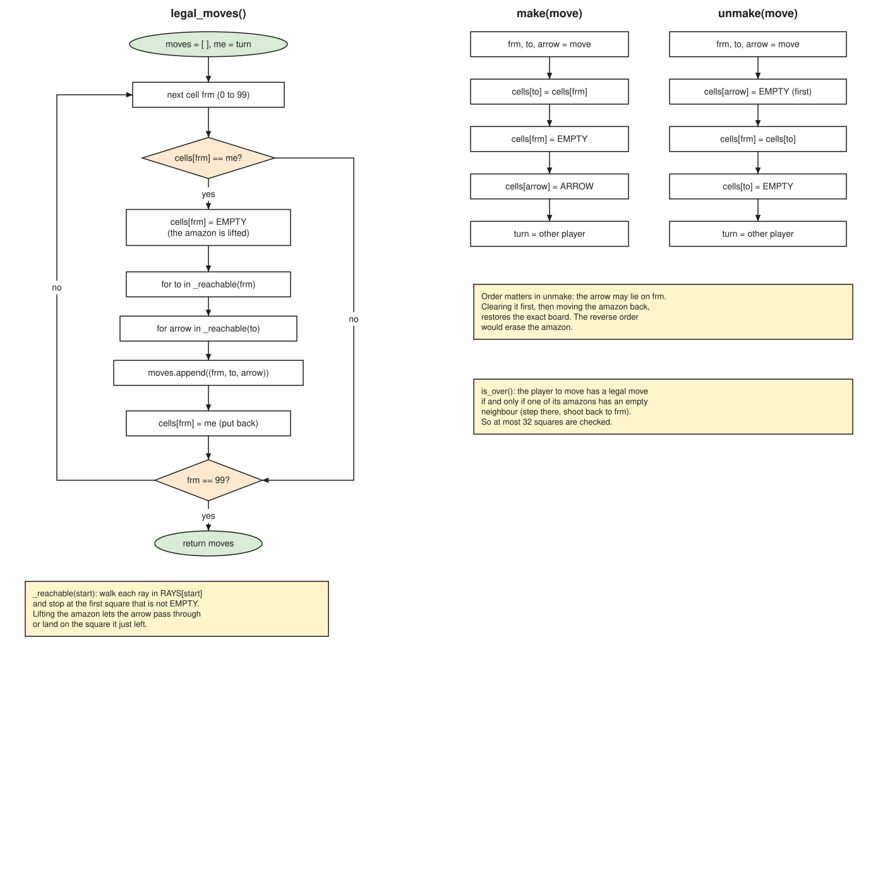

### 6.2 Search: Minimax and Alpha-Beta

`search.py` searches the game tree to a fixed depth. MAX levels are the AI's turns and MIN levels are the opponent's. At depth 0 the position is scored by the evaluation function; a position with no legal move is scored as a win or loss (±1,000,000, adjusted by depth so that faster wins are preferred). Alpha-Beta keeps the best value found so far for MAX (alpha) and for MIN (beta) and stops searching a node's remaining moves once alpha ≥ beta, because the node can no longer change the result.

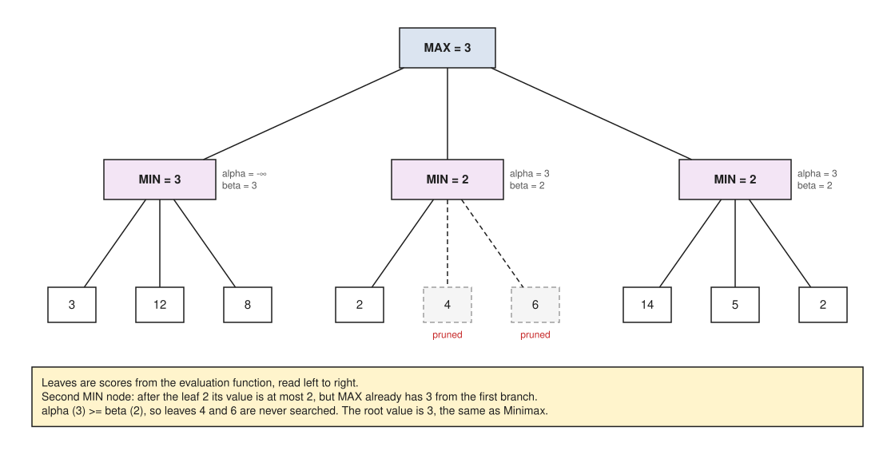

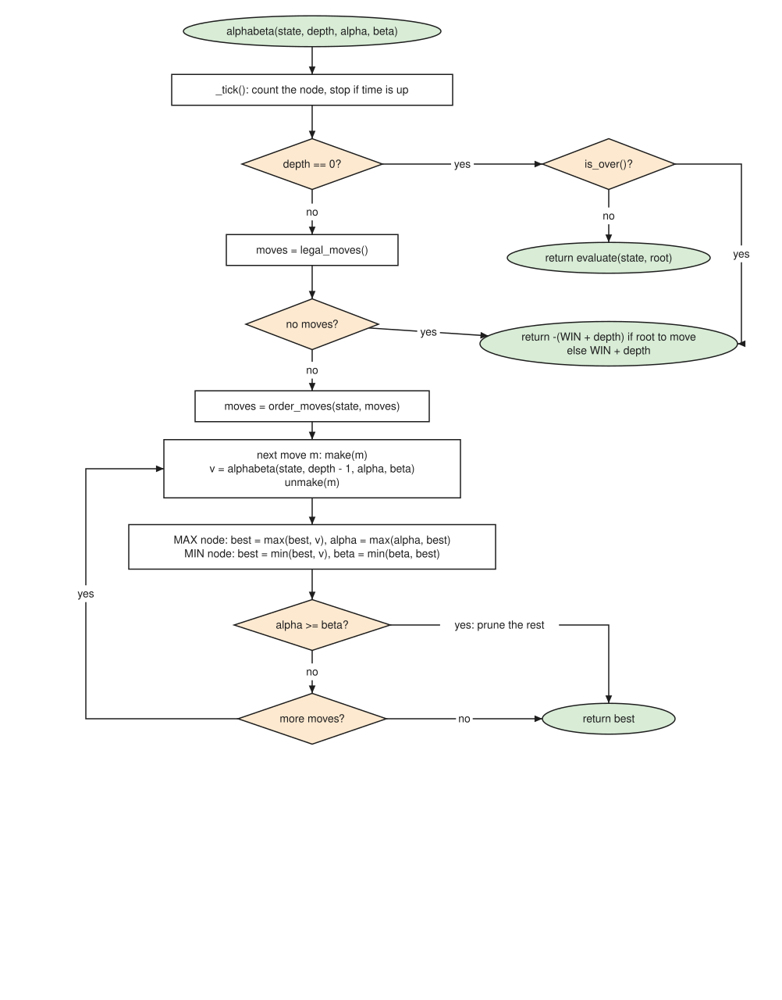

**Experiment 1: Minimax vs Alpha-Beta** (5 test positions, depths 1 to 3).

| Depth | Minimax nodes | Alpha-Beta nodes | Alpha-Beta / Minimax | Minimax time | Alpha-Beta time | Same move |
|---|---|---|---|---|---|---|
| 1 | 184 | 184 | 100% | 0.0 s | 0.0 s | 5 of 5 |
| 2 | 22,626 | 9,848 | 43.5% | 3.4 s | 1.4 s | 5 of 5 |
| 3 | 787,709 | 180,451 | 22.9% | 110.8 s | 24.4 s | 5 of 5 |

Alpha-Beta chose the same move with the same value as Minimax in every case, as the theory requires. At depth 1 nothing can be pruned. The saving grows with depth: at depth 3 Alpha-Beta searched less than a quarter of the nodes.

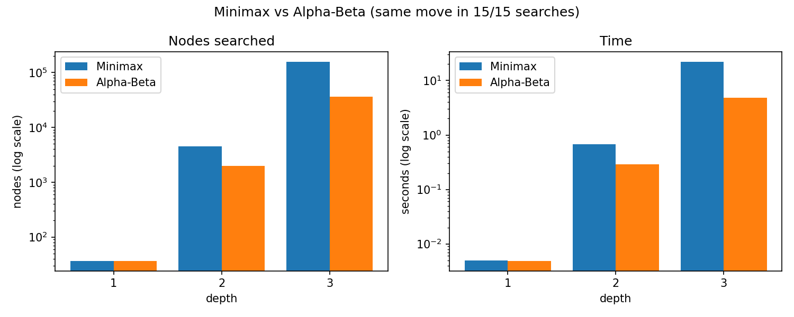

### 6.3 Move ordering

`ordering.py` sorts moves by a cheap score before they are searched: moving towards the centre, landing on a square with free neighbours, and shooting the arrow next to an enemy amazon score higher; an arrow next to one's own amazon scores lower. The score needs no search, only a look at the squares around the move.

**Experiment 2: Alpha-Beta with and without move ordering** (same 5 positions).

| Depth | Nodes, no ordering | Nodes, with ordering | Ratio | Time, no ordering | Time, with ordering |
|---|---|---|---|---|---|
| 2 | 9,848 | 2,002 | 20.3% | 1.4 s | 0.3 s |
| 3 | 180,451 | 16,015 | 8.9% | 23.9 s | 1.8 s |

The value found was the same in every case. Ordering reduced the nodes searched at depth 3 by a factor of about 11, which agrees with paper [1]: pruning depends on searching the best moves first.

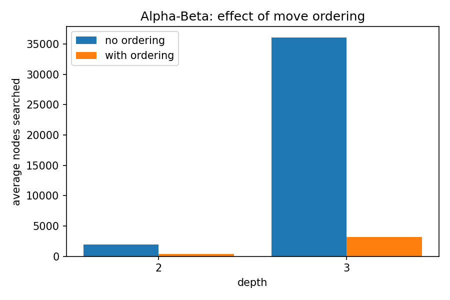

### 6.4 Iterative deepening under a time limit

`best_move(state, time_limit)` searches depth 1, then 2, then 3, and so on, each time with Alpha-Beta. The best move of each finished depth is moved to the front of the list, which improves the ordering for the next depth. The deadline is checked at every node; when it passes, the unfinished depth is dropped and the move of the last finished depth is played. If even depth 1 did not finish, the best root move found so far is played.

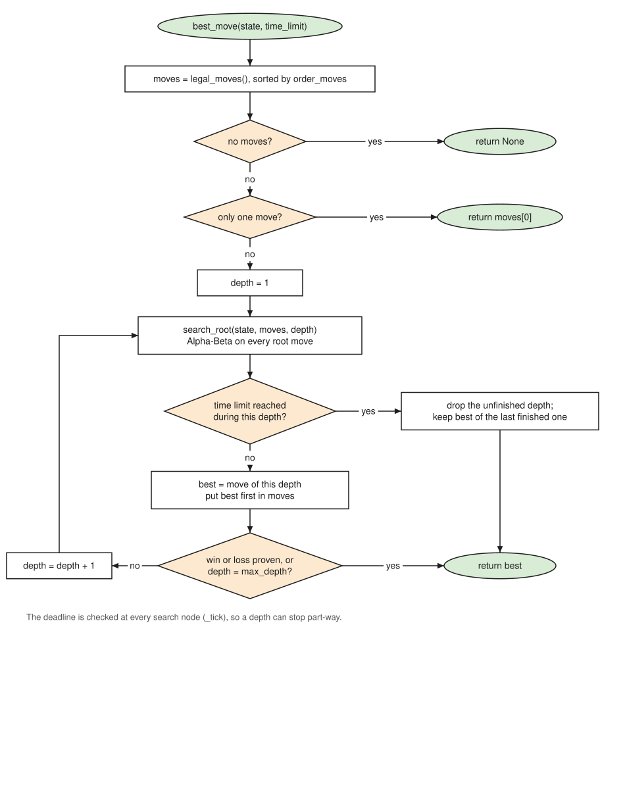

**Experiment 3: depth reached per time limit.**

| Time limit | Start position (2,176 moves) | Test positions, average (min to max) |
|---|---|---|
| 0.1 s | 0 | 1.8 (1 to 2) |
| 0.25 s | 0 | 2.4 (2 to 3) |
| 0.5 s | 0 | 3.0 (2 to 4) |
| 1.0 s | 0 | 3.4 (3 to 4) |
| 2.0 s | 1 | 3.4 (3 to 4) |

With 15 to 40 moves per position the search reaches depth 3 to 4 within one second. At the start position, even depth 1 needs about 2 seconds, because every one of the 2,176 moves must be generated, ordered and evaluated. This is the cost of a full-width search in Amazons, and the reason strong programs use selective search (papers [2] and [3]).

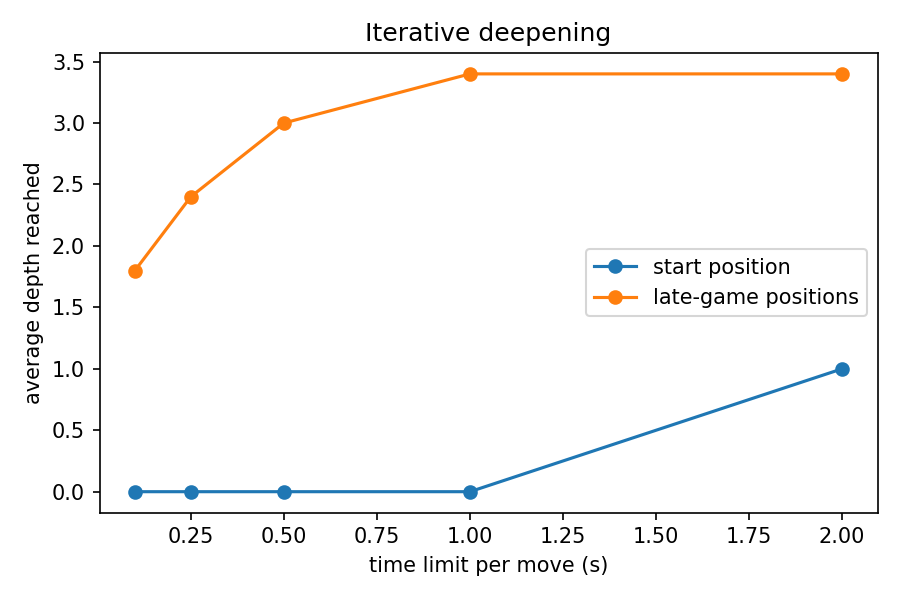

### 6.5 Evaluation function

`evaluate(state, color)` returns a score from the point of view of `color`:

`score = W1 × territory + W2 × mobility`, with `W1 = 1.0` and `W2 = 0.2`.

- Territory: a breadth-first search starts from all four amazons of one side at the same time; one step is one queen move. This gives, for every empty square, the least number of queen moves that side needs to reach it. The same is done for the other side. A square belongs to the side that reaches it in fewer moves; equal distances belong to nobody. Territory is the number of our squares minus the number of the opponent's.
- Mobility: the number of squares our amazons can move to in one queen move, minus the same number for the opponent.

The score for one side is always the negative of the score for the other, and the start position scores 0. Both properties are checked in `tests/test_evaluate.py`.

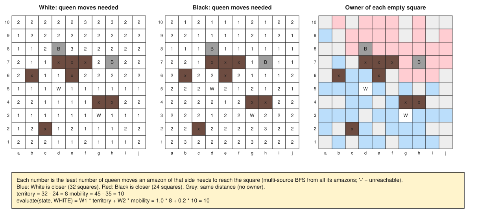

**Experiment 4: win rate.** The AI (iterative deepening, 0.3 s per move) played 10 games against each opponent, alternating colours.

| Opponent | Games | AI win rate |
|---|---|---|
| Random player | 10 | 100% |
| Depth-1 greedy player (best evaluation after one move, no time limit) | 10 | 100% |

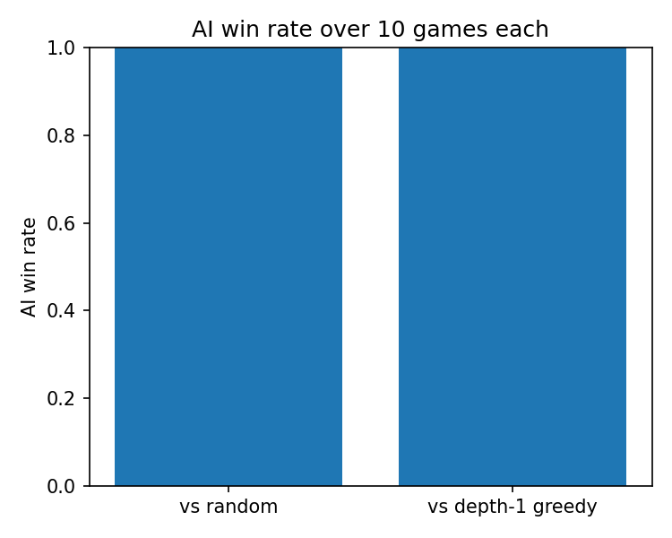

**Experiment 5: evaluation weights.** The AI played 10 games against the depth-1 greedy player with each weight setting.

| Weights (W1 territory, W2 mobility) | Games | AI win rate |
|---|---|---|
| Territory only (1, 0) | 10 | 100% |
| Mobility only (0, 1) | 10 | 0% |
| Both (1, 0.2), the values used in `evaluate.py` | 10 | 100% |

Territory decides the game. With mobility alone, the deeper search lost every game to a one-move player that uses territory: keeping amazons free to move does not stop the opponent from walling off larger regions. With only 10 games per setting, the test cannot separate "territory only" from "both"; more games would be needed to measure the value of the small mobility term.

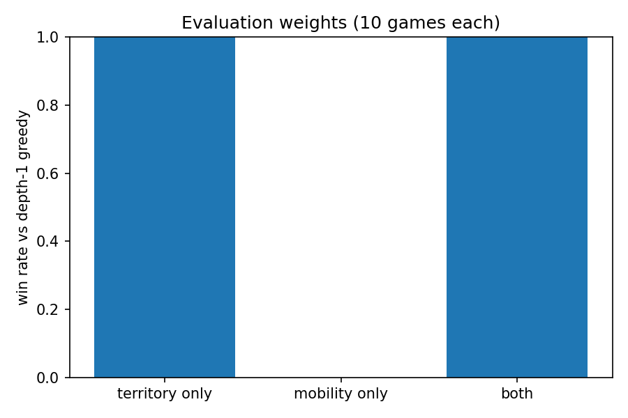

## 7. Analysis and design diagrams

| Diagram | File (Excalidraw source and SVG) | Owner |
|---|---|---|
| Use-case | `docs/diagrams/use-case` | Alaa |
| Class | `docs/diagrams/class-diagram` | Moaaz |
| Sequence of one turn | `docs/diagrams/sequence-one-turn` | Abdelrahman |
| Activity of `best_move` | `docs/diagrams/activity-best-move` | Hazem |
| Activity of one Alpha-Beta node | `docs/diagrams/activity-alphabeta` | Hazem |
| Search-tree example | `docs/diagrams/alphabeta-tree-example` | Hazem and Mohammed |
| Territory BFS worked example | `docs/diagrams/territory-bfs-example` | Marwan |
| Experiment pipeline | `docs/diagrams/experiment-pipeline` | Mohammed |
| Engine flowcharts | `docs/diagrams/engine-legal-moves-make-unmake` | Moaaz |

The `.excalidraw` files open at excalidraw.com (menu, Open) for editing.

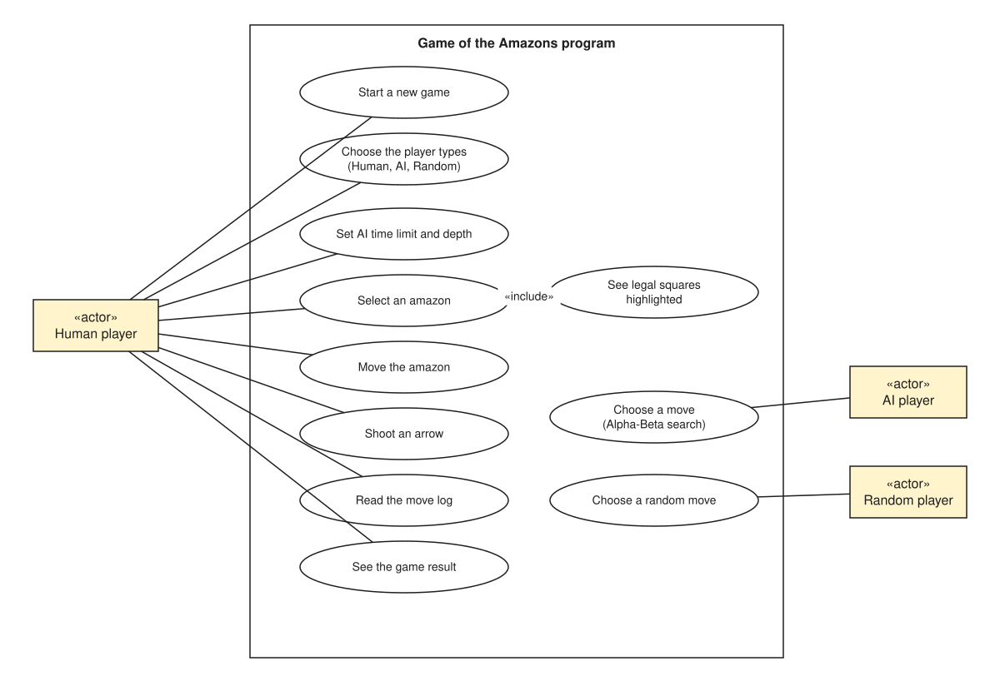

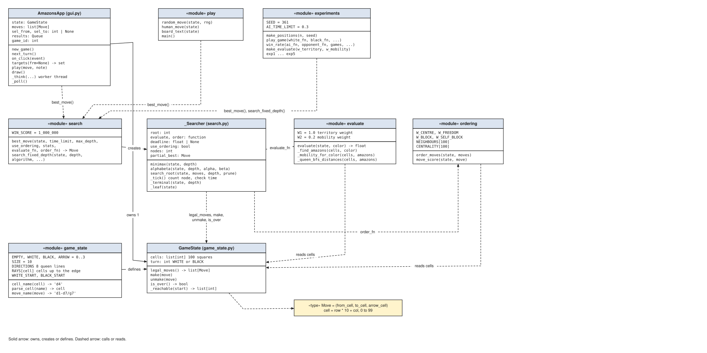

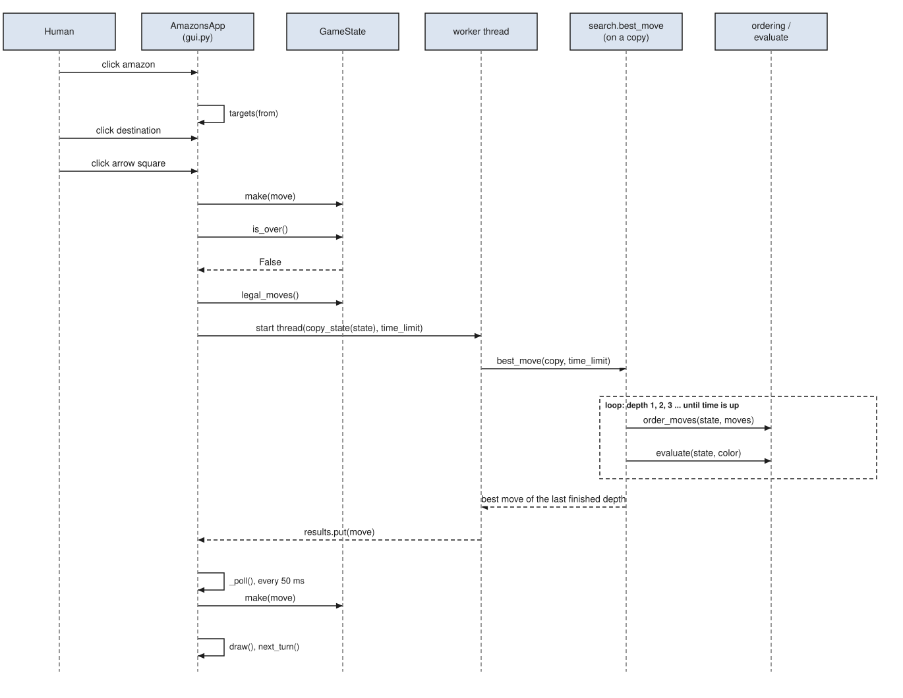

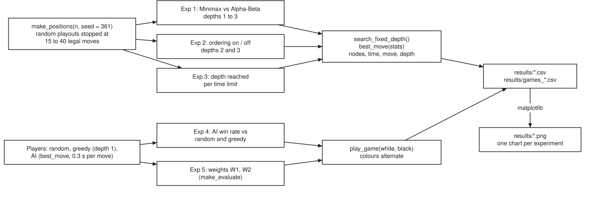

## 8. Testing

`pytest` runs 25 tests in three files.

| File | What it checks |
|---|---|
| `tests/test_game_state.py` | 2,176 moves at the start; `unmake` restores the board for every start move; the arrow may land on the vacated square; pieces block amazons and arrows; game-over detection; 50 random games with only legal moves (every move is in the legal list, the source holds the mover's amazon, the target and arrow squares are empty, at most 92 moves, one arrow per move); board notation |
| `tests/test_evaluate.py` | Mobility and BFS distances on hand-made positions; a trapped amazon gives the exact expected score; the start position scores 0; the score for one side equals minus the score for the other |
| `test_search.py` | Alpha-Beta returns the same move and value as Minimax; it searches fewer nodes; ordering searches fewer nodes; the state is restored after a search; the time limit is kept; a forced win is found |

## 9. Development platform

| Item | Used |
|---|---|
| Language | Python 3.12 |
| Libraries | Standard library (`collections.deque`, `time`, `threading`, `queue`, `tkinter`); `pytest` 7.4 for tests; `matplotlib` 3.6 for charts |
| Operating system | Ubuntu 24.04 LTS (the code runs on any system with Python 3.11 or later and tkinter) |
| IDE | Visual Studio Code |
| Version control | Git and GitHub, one branch per member, pull requests reviewed before merging |
| Diagrams | Excalidraw |

Run:

```
pip install -r requirements.txt
python gui.py                    # window
python play.py human ai          # terminal; players: human, ai, random
python experiments.py            # all experiments, results in results/
pytest                           # tests
```

## References

1. D. E. Knuth and R. W. Moore, "An Analysis of Alpha-Beta Pruning", *Artificial Intelligence*, vol. 6, no. 4, pp. 293-326, 1975.
2. P. P. L. M. Hensgens, *A Knowledge-based Approach of the Game of Amazons*, MSc thesis CS 01-09, Universiteit Maastricht, 2001.
3. H. Avetisyan and R. J. Lorentz, "Selective Search in an Amazons Program", in *Computers and Games 2002*, LNCS 2883, Springer, 2003.
4. J. Lieberum, "An Evaluation Function for the Game of Amazons", *Theoretical Computer Science*, vol. 349, no. 2, pp. 230-244, 2005.
5. J. Kloetzer, H. Iida and B. Bouzy, "The Monte-Carlo Approach in Amazons", in *Proceedings of the Computer Games Workshop 2007*, Amsterdam, 2007.
6. R. J. Lorentz, "Amazons Discover Monte-Carlo", in *Computers and Games 2008*, LNCS 5131, Springer, 2008.
7. PlayStrategy, Amazons variant: https://playstrategy.org/variant/amazons
8. Little Golem: https://www.littlegolem.net
